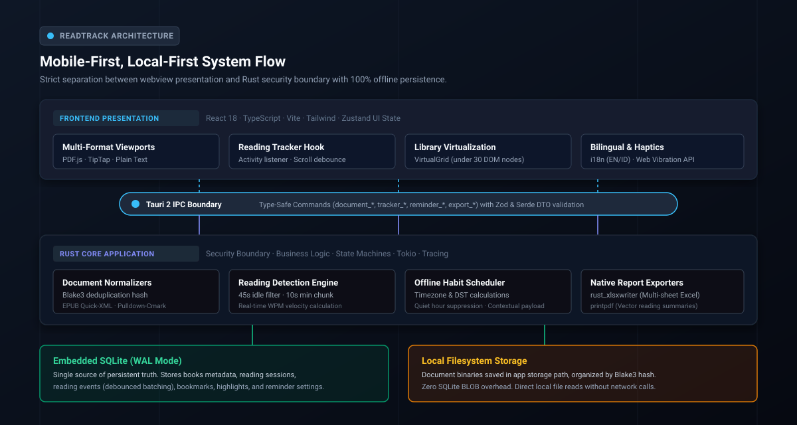
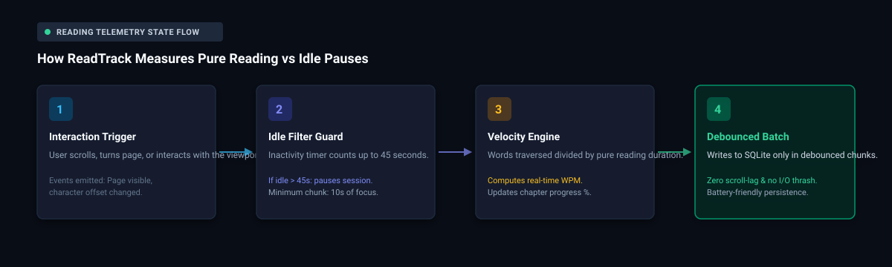

<div align="center">

[English](README.md) · **Bahasa Indonesia**

# ReadTrack

### Document reader dan interactive reading tracker lokal-pertama untuk Android dan desktop.

**Baca dokumen Anda secara privat. Ukur waktu membaca sesungguhnya tanpa pengawasan cloud.**

[](LICENSE)
[](https://v2.tauri.app)
[](src-tauri/)
[](docs/DATABASE.md)
[](src/)
[](docs/TESTING.md)
[](#prinsip-lokal-pertama)

**[Mulai Cepat](#mulai-cepat) · [Cara Kerja ReadTrack](#cara-kerja-readtrack) · [Format yang Didukung](#format-yang-didukung) · [Studi Kasus](#studi-kasus) · [Tanya Jawab (FAQ)](#tanya-jawab-faq) · [Dokumentasi](#dokumentasi-teknis)**

<code>pnpm tauri dev</code> &nbsp;&nbsp;|&nbsp;&nbsp; <code>adb install -r dist-apk/readtrack-arm64-debug.apk</code>

<br /><br />



<br /><br />

<table aria-label="Komitmen privasi ReadTrack">
<tr>
<td align="center" width="800">
  <strong>Komitmen 100% Lokal-Pertama</strong><br />
  <sub>Tanpa akun · Tanpa analitik eksternal · Tanpa upload telemetri · Data persisten 100% di perangkat Anda</sub>
</td>
</tr>
</table>

<br />

</div>

---

Aplikasi membaca digital kerap kali mewajibkan akun cloud, mengirim tiap perpindahan halaman ke server analitik, dan berhenti berfungsi ketika gawai kehilangan koneksi internet.

ReadTrack berjalan sepenuhnya di perangkat lokal Anda. Aplikasi ini memadukan document reader multi-format dengan mesin telemetri aktif yang mengukur kecepatan membaca nyata sekaligus menyaring jeda diam saat layar ditinggal. Berkas buku, catatan baca, sorotan teks, dan konfigurasi pengingat disimpan aman di SQLite lokal dan ruang penyimpanan berkas aplikasi.

## Mulai Cepat

### Prasyarat

- Node.js 20 ke atas, dengan pnpm
- Toolchain Rust versi stabil (`rustup default stable`)
- Webview sistem: WebView2 (bawaan Windows), WebKitGTK (Linux), atau Xcode CLI (macOS)
- Android Studio dengan SDK Platform 34 dan NDK (opsional, untuk pengembangan Android)

### Menjalankan di Desktop

Pasang dependensi antarmuka dan jalankan shell pengembangan desktop:

```bash
pnpm install
pnpm tauri dev
```

### Memasang di Android

#### Pilihan A: Pasang berkas APK yang sudah dibangun

Jika Anda memiliki perangkat Android atau emulator dengan USB debugging aktif:

```bash
adb install -r dist-apk/readtrack-arm64-debug.apk
```

#### Pilihan B: Jalankan dev loop Android

```bash
pnpm tauri android dev
```

### Verifikasi Pengujian

ReadTrack dilengkapi 259 pengujian otomatis mencakup antarmuka frontend dan mesin Rust:

```bash
# Pengujian frontend (172 Vitest tests, ESLint, TypeScript)
pnpm typecheck
pnpm lint
pnpm test

# Pengujian backend (87 Rust tests, Clippy linting, format)
cd src-tauri
cargo test
cargo clippy -- -D warnings
cargo fmt --check
```

---

## Cara Kerja ReadTrack

ReadTrack memisahkan tampilan antarmuka dari logika bisnis utama melalui batas IPC Tauri 2. Frontend React menangani interaksi pengguna dan visualisasi tampilan, sementara mesin Rust menjadi batas keamanan, menangani penguraian berkas (parsing), menjalankan mesin state telemetri, dan mengelola database.



### Alur Deteksi Membaca

1. **Pemicu Interaksi**: Saat Anda menggulir layar, membalik halaman, atau berinteraksi dengan buku, reader memancarkan event viewport ringan (indeks halaman tampak, offset karakter).
2. **Penyaring Jeda Diam**: Pelacak memantau durasi aktif. Jika layar dibiarkan menyala tanpa sentuhan lebih dari 45 detik, mesin otomatis menjeda sesi membaca agar waktu diam tidak menggelembungkan statistik.
3. **Kalkulasi Kecepatan**: Waktu membaca murni dipadukan dengan jumlah kata untuk menghitung kecepatan membaca nyata dalam kata per menit (WPM).
4. **Penyimpanan Berkala (Debounced)**: Pembaruan telemetri ditampung sementara di memori lalu ditulis ke SQLite secara bertahap untuk mencegah keausan storage dan menghemat daya baterai.

---

## Format yang Didukung

ReadTrack menstandarkan seluruh format ke dalam representasi terpadu `LogicalPosition`:

| Format | Mesin Pengurai | Pengukuran Progres | Kemampuan Utama |
|---|---|---|---|
| **PDF** | PDF.js | Indeks halaman, scroll offset | Pemilihan teks, render canvas, zoom, navigasi kerangka, sorotan teks |
| **EPUB** | Quick-XML + Rust Spine | Bobot kata per bab | Bab ternormalisasi, pengaturan font, daftar isi, penanda buku |
| **Markdown** | Pulldown-Cmark + TipTap | Anchor tajuk, block offset | Tajuk terstruktur, blok kode, kutipan, estimasi waktu baca |
| **Teks Polos (TXT)** | Native Rust Chunk Parser | Offset karakter dan paragraf | Tampilan paragraf bertahap, hitungan kata, pengindeksan cepat |

---

## Prinsip Lokal-Pertama

- **Penyimpanan Biner**: Berkas yang diimpor diverifikasi, di-hash dengan Blake3 untuk mencegah duplikasi, dan disimpan di direktori data aplikasi lokal. Berkas tidak pernah disimpan sebagai BLOB di database SQLite.
- **Sumber Kebenaran Tunggal**: SQLite dengan Write-Ahead Logging (WAL) dan foreign keys aktif menangani seluruh data persisten. State sementara di React (Zustand) tidak diduplikasi ke penyimpanan permanen.
- **Tanpa Angka Palsu**: Seluruh statistik dan kecepatan baca dihitung langsung dari stempel waktu database dan jumlah kata nyata.

---

## Studi Kasus

### 1. Telemetri Membaca Aktif vs Layar Menganggur

Banyak aplikasi membaca hanya mengandalkan timer biasa: jika Anda meninggalkan buku terbuka karena menerima panggilan telepon, catatan membaca Anda akan mencatat waktu berjam-jam yang keliru.

ReadTrack menerapkan state machine ganda. Interaksi di bawah 10 detik dianggap sekilas pandang, sementara jeda diam lebih dari 45 detik otomatis menonaktifkan penghitungan sesi. Saat Anda kembali menyentuh layar, sesi membaca berlanjut secara bersih, menjaga akurasi hitungan Kata Per Menit (WPM) dan total durasi membaca harian Anda.

### 2. Efisiensi Baterai Melalui Batching SQLite

Penulisan database pada tiap piksel pergeseran layar dapat menimbulkan lag tampilan dan menguras daya baterai gawai.

ReadTrack menampung event telemetri dalam ring buffer memori. Data baru dialirkan ke SQLite dalam kelompok bertahap saat jeda scroll alami atau saat bab berganti. Langkah ini menjaga penggunaan disk tetap rendah tanpa risiko kehilangan data telemetri.

### 3. Pembuatan Dokumen Excel Multi-Sheet Asli dari Rust

Banyak aplikasi mengekspor data sebagai berkas comma-separated values (CSV) lalu mengganti ekstensinya menjadi `.xlsx`.

ReadTrack memproduksi berkas biner Excel asli langsung dari Rust menggunakan pustaka `rust_xlsxwriter`. Lembar kerja yang diekspor berisi multi-sheet terstruktur:
- **Sheet Ringkasan**: Statistik inti, total durasi membaca, dan rekor hari berturut-turut.
- **Katalog Buku**: Daftar lengkap koleksi buku, ukuran berkas, format, dan persentase penyelesaian.
- **Log Sesi Membaca**: Rincian stempel waktu tiap sesi, volume kata, dan kecepatan baca terukur.

---

## Tanya Jawab (FAQ)

<details>
<summary><strong>Apakah ReadTrack terhubung ke server atau API eksternal?</strong></summary>

Tidak. ReadTrack sama sekali tidak membuat panggilan jaringan internet. Tidak ada endpoint API jarak jauh, tidak ada pengumpul analitik pihak ketiga, dan tidak ada server akun. Aplikasi beroperasi penuh dalam mode pesawat (offline).

</details>

<details>
<summary><strong>Di mana berkas buku dan catatan saya disimpan?</strong></summary>

Seluruh berkas buku disimpan di direktori data aplikasi lokal pada perangkat Anda, diatur berdasarkan hash konten Blake3. Riwayat baca, penanda halaman, sorotan teks, dan konfigurasi pengingat disimpan dalam database SQLite lokal (`readtrack.db`).

</details>

<details>
<summary><strong>Bagaimana pengingat kebiasaan membaca bekerja tanpa notifikasi cloud?</strong></summary>

ReadTrack menjadwalkan notifikasi menggunakan sistem notifikasi lokal sistem operasi melalui plugin Tauri. Perhitungan jadwal dijalankan di Rust, memperhitungkan zona waktu lokal, pergantian Daylight Saving Time (DST), dan penonaktifan otomatis pada jam istirahat malam.

</details>

<details>
<summary><strong>Bagaimana cara memasang ReadTrack di perangkat Android?</strong></summary>

Anda dapat memasang paket debug yang sudah siap menggunakan Android Debug Bridge (ADB):

```bash
adb install -r dist-apk/readtrack-arm64-debug.apk
```

Atau, Anda dapat melakukan kompilasi berkas APK release langsung dari kode sumber menggunakan perintah `pnpm tauri android build --apk`.

</details>

<details>
<summary><strong>Mengapa ReadTrack menggunakan Rust untuk logika inti dan bukan TypeScript murni?</strong></summary>

Rust berperan sebagai batas keamanan saat mengolah berkas dokumen dari luar (PDF, EPUB, Markdown). Menjalankan parsing, hashing, state machine, dan operasi database dalam Rust bawaan menjamin performa cepat, keamanan memori, serta konsumsi daya baterai yang sangat hemat di perangkat ponsel.

</details>

<details>
<summary><strong>Apakah data membaca saya bisa diekspor atau dicadangkan?</strong></summary>

Ya. ReadTrack menyediakan dua sarana ekspor:
1. **Ekspor Spreadsheet & PDF**: Berkas Excel multi-sheet asli (`.xlsx`) dan ringkasan baca cetak (`.pdf`).
2. **Cadangan Basis Data Utuh**: Ekspor JSON lengkap dari seluruh tabel database untuk keperluan backup atau migrasi pribadi.

</details>

---

## Dokumentasi Teknis

Spesifikasi arsitektur dan panduan implementasi lengkap tersedia di folder `docs/`:

- [Kebutuhan Produk (PRD)](docs/PRD.md): Sasaran, user story, dan kriteria penerimaan.
- [Arsitektur](docs/ARCHITECTURE.md): Lapisan sistem, kontrak IPC, dan batas keamanan.
- [Skema Basis Data](docs/DATABASE.md): Definisi tabel SQLite, indeks, dan riwayat migrasi.
- [Model Dokumen](docs/DOCUMENT_MODEL.md): Normalisasi `LogicalPosition` dan trait pengurai.
- [Spesifikasi Pelacak Baca](docs/TRACKER_SPEC.md): Algoritma deteksi aktif vs jeda diam.
- [Kontrak API IPC](docs/API_CONTRACT.md): Perintah Tauri, event, dan skema DTO bertipe.
- [Pedoman Desain](docs/DESIGN.md): Desain token, palet warna, dan aturan gestur layar sentuh.
- [Model Keamanan](docs/SECURITY.md): Vektor ancaman dan pengolahan berkas tidak tepercaya.
- [Strategi Pengujian](docs/TESTING.md): Matriks uji, berkas fixture, dan syarat verifikasi.
- [Peta Rencana (Roadmap)](docs/ROADMAP.md): Daftar periksa fase implementasi 1 hingga 8.

---

## Kontribusi

Kontribusi kode dan masukan selalu diterima. Sebelum mengajukan pull request, pastikan seluruh pengujian berjalan lancar:

```bash
# Pengujian frontend
pnpm typecheck && pnpm lint && pnpm test

# Pengujian backend Rust
cd src-tauri && cargo test && cargo clippy -- -D warnings && cargo fmt --check
```

---

## Lisensi

ReadTrack adalah perangkat lunak sumber terbuka yang dilisensikan di bawah [MIT License](LICENSE).
